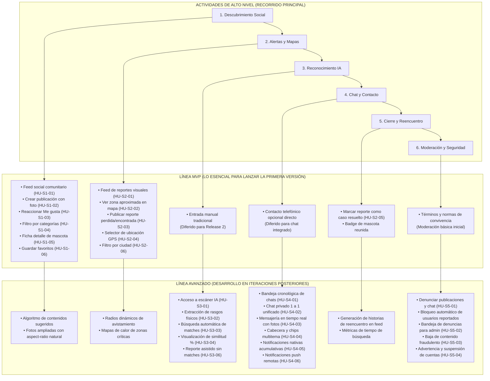

# User Story Mapping — Yago

**Proyecto:** Yago — Red comunitaria para la búsqueda y reencuentro de mascotas perdidas  
**Cátedra:** (2138) Laboratorio de Desarrollo de Software (2026)  
**Versión:** 2.0  
**Fecha:** Noviembre 2026  

---

## 1. Objetivos Principales (Backbone / Actividades de Alto Nivel)

El **Backbone** o columna vertebral del sistema representa las actividades esenciales que realizan tanto los **vecinos de la comunidad** como los **administradores**, ordenadas de forma cronológica según su interacción con Yago:

### Recorrido Principal del Usuario (Vecino de la comunidad):
1. **Descubrimiento y Participación Social:** Explorar el feed comunitario con historias de reencuentro, momentos y consejos, filtrar por categorías de interés e interactuar guardando contenido.
2. **Alertas y Búsqueda Geolocalizada:** Consultar alertas de mascotas perdidas y encontradas, filtrar por ciudad, ver la zona de avistamiento en un mapa contextual y publicar nuevos reportes con foto y ubicación.
3. **Reconocimiento Asistido con Inteligencia Artificial:** Tomar una fotografía de un animal en la vía pública para que el motor de IA extraiga sus rasgos físicos y busque automáticamente coincidencias con reportes activos.
4. **Comunicación y Coordinación Directa:** Iniciar un chat privado y confidencial 1 a 1 con el responsable de una publicación o reporte, coordinar pistas en tiempo real y recibir avisos en el celular.
5. **Cierre y Resolución del Caso:** Actualizar y dar por finalizado un reporte cuando la mascota ha sido recuperada, adoptada o el caso concluye formalmente.

### Recorrido Principal del Administrador (Moderación y Seguridad):
6. **Moderación y Convivencia Segura:** Supervisar la plataforma, recibir denuncias de la comunidad ante contenido fraudulento o indebido, aplicar bajas de publicaciones y suspender usuarios infractores.

---

## 2. User Story Map: Ejemplo con una Actividad

A continuación se ilustra la descomposición de la actividad **"Alertas y Búsqueda Geolocalizada"** en pasos de usuario secuenciales, diferenciando las tareas esenciales del MVP de las funcionalidades avanzadas:

### Actividad: Alertas y Búsqueda Geolocalizada
* **Paso 1: Consultar alertas comunitarias**
  * *Tareas MVP:*
    * `HU-S2-01:` Feed dedicado con tarjetas visuales priorizadas y badges de estado (`Perdida` / `Encontrada`).
    * `HU-S2-06:` Filtro de reportes por localidad o ciudad (estilo marketplace).
  * *Tareas Avanzado:*
    * Ordenamiento dinámico según cercanía geográfica y radios de alerta por barrio.
* **Paso 2: Visualizar la zona del reporte**
  * *Tareas MVP:*
    * `HU-S2-02:` Botón "Ver zona en mapa" que despliega un visor contextual con el radio aproximado del barrio (sin revelar domicilio exacto por seguridad).
  * *Tareas Avanzado:*
    * Rutas de avistamientos cronológicos y mapa interactivo de calor con avistamientos recientes.
* **Paso 3: Publicar una alerta de mascota**
  * *Tareas MVP:*
    * `HU-S2-03:` Formulario de publicación con foto, especie neutral (Regla 4), raza, colores y fecha.
    * `HU-S2-04:` Marcación de ubicación en mapa interactivo o detección automática de coordenadas por GPS.
  * *Tareas Avanzado:*
    * `HU-S3-06:` Generación asistida del reporte reutilizando la foto y atributos detectados previamente por la cámara IA.

---

## 3. Cómo Leer el Mapa

El User Story Map se organiza en dos dimensiones ortogonales:

* **Fila Superior (Actividades):** Representa el recorrido horizontal de alto nivel del usuario comunitario y del administrador a lo largo de todo el ciclo de vida del producto.
* **Nivel / Fila MVP (Minimum Viable Product):** Contiene las funcionalidades y tareas indispensables para lanzar la primera versión del sistema (cubiertas en los **Sprints 1 y 2**). Garantiza que la comunidad pueda registrarse, publicar alertas, ubicarlas en mapa y cerrar reportes resueltos.
* **Nivel / Fila Avanzado:** Funcionalidades complejas e incrementales desarrolladas en iteraciones posteriores (**Sprints 3, 4 y 5**), que incorporan el escáner neuronal con IA, la mensajería directa en tiempo real con notificaciones acumulativas y el módulo de moderación y seguridad.

---

## 4. Diagrama del User Story Mapping

